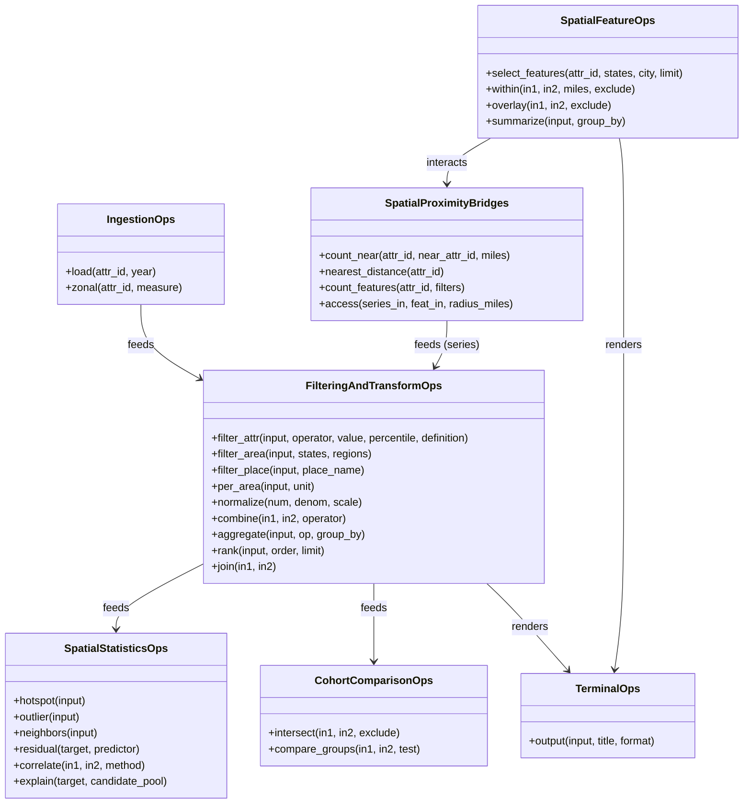

# GeoARK Operations & Plan Vocabulary: Complete Reference Guide

This document is an exhaustive, scrollable reference for all **28 public operations** (plus the internal level aggregation op) in the GeoARK planning algebra. It details type signatures, DSL and JSON syntax, parameter definitions, natural language trigger phrasing, gating predicates, and underlying PostGIS SQL compilation strategies.

---

## 1. Architectural Foundations of the Op Algebra

The GeoARK planning engine enforces a fundamental safety and reliability boundary: **the language model never writes SQL, database table names, or physical column names**.

```
User Natural Language Query
         │
         ▼
  Retrieval & Grounding         (Retrieves candidate attributes aliased as a1, a2, ...)
         │
         ▼
  Constrained Plan Generation   (Model emits typed AST or 1-Line DSL over closed ops)
         │
         ▼
  Deterministic Type Validator  (Enforces 5-type algebra, DAG acyclicity, and grounding)
         │  (Self-repair loop if validation fails)
         ▼
  Deterministic SQL Compiler    (Translates AST nodes into parameterized PostGIS CTEs)
         │
         ▼
  Read-Only Database Sandbox    (Executes in PostgreSQL with statement_timeout)
```

### The 5 Core Data Types

Every step in an analytical DAG produces exactly one of five verified types. The validator ensures that an input feeding an operator matches one of the types that operator `accepts`:

| Data Type | Structural Contract | Emitted By | Consumed By |
| :--- | :--- | :--- | :--- |
| **`series`** | Tuples: `(fips, value)` per geographic unit | `load`, `count_features`, `count_near`, `nearest_distance`, `per_area`, `normalize`, `combine`, `aggregate`, `hotspot`, `outlier`, `neighbors`, `residual`, `access`, `zonal` | All series arithmetic, spatial filters, statistical ops, `rank`, `output` |
| **`features`** | Geometries + properties: `(geom, properties)` | `select_features`, `within`, `overlay`, `rank` on features, `filter_attr` on features | `within`, `overlay`, `summarize`, `rank`, `filter_attr`, `output` |
| **`scalar`** | Single row / single value (no geographic key) | Ungrouped `aggregate`, `summarize` with `group_by: "none"` | `combine`, `normalize`, `output` |
| **`statistic`** | Summary statistics matrix (`r`, `p-value`, $N$) | `correlate` | `output` |
| **`factors`** | Ranked explanatory variance matrix | `explain` | `output` |

---

## 2. Operator Families & Functional Hierarchy



---

## 3. Complete Operator Catalog

### Family 1: Data Ingestion & Bridge Operators

---

#### 1. `load`
*Loads a tabular census variable, demographic estimate, or precomputed index per geographic unit.*

- **Type Contract**: `() → series`
- **Arity**: 0 inputs (`inputs: []`)
- **Required Fields**: `attr_id`
- **Optional Fields**: `year` (integer, e.g. 2021), `level` ("county", "tract", "zip", "place")
- **Gating Predicate**: Always offered when candidate tabular attributes exist.
- **Natural Language Triggers**: *"show poverty rate"*, *"median income"*, *"unemployment"*, *"population"*.
- **1-Line DSL Syntax**:
  ```text
  load(a1)
  load(a1, year=2021)
  ```
- **JSON AST Syntax**:
  ```json
  {
    "id": "s1",
    "op": "load",
    "attr_id": "a1",
    "inputs": [],
    "year": 2021
  }
  ```
- **SQL Compilation Strategy**:
  Compiles to a CTE selecting from `acs_county_values` (or tract/ZIP tables) filtered by `variable_id = $1` and `year = $2`, joining on geographic identifier `geoid AS fips`.

---

#### 2. `count_features`
*Counts the number of point, line, or polygon features belonging to a layer located within each geographic unit.*

- **Type Contract**: `() → series`
- **Arity**: 0 inputs (`inputs: []`)
- **Required Fields**: `attr_id`
- **Optional Fields**: `attribute_filters` (array of key-value constraints)
- **Gating Predicate**: Offered when candidate facility or infrastructure layers exist.
- **Natural Language Triggers**: *"how many hospitals in each county"*, *"count fire stations"*, *"number of public schools"*.
- **1-Line DSL Syntax**:
  ```text
  count_features(a2)
  count_features(a2, type="CRITICAL ACCESS")
  ```
- **JSON AST Syntax**:
  ```json
  {
    "id": "s1",
    "op": "count_features",
    "attr_id": "a2",
    "inputs": [],
    "attribute_filters": [{"column": "type", "value": "CRITICAL ACCESS"}]
  }
  ```
- **SQL Compilation Strategy**:
  Compiles a `LEFT JOIN` between `county_geom` and the feature table using spatial intersection: `ST_Intersects(county_geom.geom, feat.geom)`. Aggregates with `COUNT(feat.geom) GROUP BY county_geom.fips`.

---

#### 3. `count_near`
*Counts features in Layer A located within a specified radius (in miles) of features in Layer B, aggregated per geographic unit.*

- **Type Contract**: `() → series`
- **Arity**: 0 inputs (`inputs: []`)
- **Required Fields**: `attr_id` (Layer A), `near_attr_id` (Layer B), `miles` (number)
- **Gating Predicate**: Offered when at least two feature datasets appear in candidate pool and distance phrasing is present.
- **Natural Language Triggers**: *"schools within 5 miles of chemical facilities"*, *"hospitals within 3 miles of nursing homes"*.
- **1-Line DSL Syntax**:
  ```text
  count_near(a1, a2, miles=5)
  ```
- **JSON AST Syntax**:
  ```json
  {
    "id": "s1",
    "op": "count_near",
    "attr_id": "a1",
    "near_attr_id": "a2",
    "miles": 5,
    "inputs": []
  }
  ```
- **SQL Compilation Strategy**:
  Uses a two-stage spatial filter for high performance:
  1. **Bounding Box Pre-filter**: `feat_a.geom && ST_Expand(feat_b.geom, distance)` with spherical longitude correction factor ($1/\cos(\text{lat})$). Utilizes PostGIS GIST spatial indexes.
  2. **Exact Geodesic Distance**: `ST_DWithin(feat_a.geom::geography, feat_b.geom::geography, $miles * 1609.34)`.

---

#### 4. `nearest_distance`
*Calculates the geodesic distance (in miles) from each unit's centroid to the closest feature in a target layer.*

- **Type Contract**: `() → series`
- **Arity**: 0 inputs (`inputs: []`)
- **Required Fields**: `attr_id`
- **Gating Predicate**: Offered on proximity inquiries (*"distance to"*, *"nearest"*, *"how far"*).
- **Natural Language Triggers**: *"distance to the nearest hospital"*, *"miles to closest emergency room"*, *"how far to fire station"*.
- **1-Line DSL Syntax**:
  ```text
  nearest_distance(a3)
  ```
- **JSON AST Syntax**:
  ```json
  {
    "id": "s1",
    "op": "nearest_distance",
    "attr_id": "a3",
    "inputs": []
  }
  ```
- **SQL Compilation Strategy**:
  Combines PostGIS planar 2D KNN `<->` with spherical refinement:
  Takes the KNN closest row to find an initial upper bound $d_0$, expands an index bounding box by $d_0$, and computes the exact geodesic minimum over that subset in **181 ms** nationally. Avoids combinatorial $O(N \times M)$ cross joins.

---

#### 5. `zonal`
*Calculates summary statistics (sum, mean) of a continuous raster surface (e.g. WorldPop, LandScan) over polygon boundaries.*

- **Type Contract**: `() → series`
- **Arity**: 0 inputs (`inputs: []`)
- **Required Fields**: `attr_id`
- **Optional Fields**: `measure` ("sum", "mean")
- **Gating Predicate**: Offered exclusively when raster catalog attributes are retrieved.
- **Natural Language Triggers**: *"population from raster"*, *"gridded population total"*, *"surface density"*.
- **1-Line DSL Syntax**:
  ```text
  zonal(a1, measure="sum")
  ```
- **JSON AST Syntax**:
  ```json
  {
    "id": "s1",
    "op": "zonal",
    "attr_id": "a1",
    "measure": "sum",
    "inputs": []
  }
  ```
- **SQL Compilation Strategy**:
  Reads precomputed raster zonal summary tables or executes `ST_SummaryStats` over raster tiles intersecting unit geometries.

---

### Family 2: Geospatial Feature Algebra Operators

---

#### 6. `select_features`
*Queries raw point, line, or polygon geometry entities with their attributes, subject to place or attribute filters.*

- **Type Contract**: `() → features`
- **Arity**: 0 inputs (`inputs: []`)
- **Required Fields**: `attr_id`
- **Optional Fields**: `states` (array of state names), `city` (string), `limit` (integer), `attribute_filters`
- **Gating Predicate**: Offered on location queries (*"where are the..."*, *"map the locations of..."*, *"list all..."*).
- **Natural Language Triggers**: *"where are Superfund sites in Missouri"*, *"show hospitals in St. Louis"*, *"map toxic release facilities"*.
- **1-Line DSL Syntax**:
  ```text
  select_features(a4, states=["Missouri"], limit=50)
  select_features(a4, city="Springfield")
  ```
- **JSON AST Syntax**:
  ```json
  {
    "id": "s1",
    "op": "select_features",
    "attr_id": "a4",
    "states": ["Missouri"],
    "limit": 50,
    "inputs": []
  }
  ```
- **SQL Compilation Strategy**:
  Emits `SELECT id, name, geom, properties FROM table WHERE state = $1 LIMIT $2`. Declares `NOT MATERIALIZED` in CTE headers so downstream spatial joins probe the underlying table's GIST index.

---

#### 7. `within`
*Filters a feature stream to only those entities located within a specified radius of a second reference feature layer.*

- **Type Contract**: `(features, features) → features`
- **Arity**: 2 inputs (`inputs: ["s1", "s2"]`)
- **Required Fields**: `miles` (number)
- **Optional Fields**: `exclude` (boolean, default: false)
- **Gating Predicate**: Offered when distance phrasing links two feature sets.
- **Natural Language Triggers**: *"hospitals within 10 miles of flood zones"*, *"nursing homes not within 5 miles of fire stations"* (`exclude: true`).
- **1-Line DSL Syntax**:
  ```text
  within(s1, s2, miles=5)
  within(s1, s2, miles=5, exclude=true)
  ```
- **JSON AST Syntax**:
  ```json
  {
    "id": "s3",
    "op": "within",
    "inputs": ["s1", "s2"],
    "miles": 5,
    "exclude": false
  }
  ```
- **SQL Compilation Strategy**:
  When `exclude: false`: `SELECT s1.* FROM s1 WHERE EXISTS (SELECT 1 FROM s2 WHERE ST_DWithin(s1.geom::geography, s2.geom::geography, $miles * 1609.34))`.  
  When `exclude: true`: Emits `NOT EXISTS` anti-join.

---

#### 8. `overlay`
*Filters features using topological polygon relationships (intersects, contains, within) against a reference boundary layer without requiring a distance metric.*

- **Type Contract**: `(features, features) → features`
- **Arity**: 2 inputs (`inputs: ["s1", "s2"]`)
- **Optional Fields**: `predicate` ("intersects", "within", "contains"), `exclude` (boolean)
- **Gating Predicate**: Offered when spatial containment/intersection phrasing connects a point/line layer to a polygon layer.
- **Natural Language Triggers**: *"parcels inside 100-year flood zones"*, *"schools outside wildfire perimeter"* (`exclude: true`).
- **1-Line DSL Syntax**:
  ```text
  overlay(s1, s2)
  overlay(s1, s2, exclude=true)
  ```
- **JSON AST Syntax**:
  ```json
  {
    "id": "s3",
    "op": "overlay",
    "inputs": ["s1", "s2"],
    "predicate": "intersects",
    "exclude": false
  }
  ```
- **SQL Compilation Strategy**:
  Compiled as: `SELECT s1.* FROM s1 WHERE EXISTS (SELECT 1 FROM s2 WHERE s1.geom && s2.geom AND ST_Intersects(s1.geom, s2.geom))`.

---

#### 9. `summarize`
*Aggregates a feature stream into unit counts or sums, grouped by geographic regions or globally as a scalar.*

- **Type Contract**: `(features) → series` OR `(features) → scalar`
- **Arity**: 1 input (`inputs: ["s1"]`)
- **Optional Fields**: `group_by` ("state", "county", "none", default: "state")
- **Gating Predicate**: Offered when counting or summing over feature streams.
- **Natural Language Triggers**: *"how many per state"*, *"total nationwide count"*, *"summarize by region"*.
- **1-Line DSL Syntax**:
  ```text
  summarize(s1, group_by="state")
  summarize(s1, group_by="none")
  ```
- **JSON AST Syntax**:
  ```json
  {
    "id": "s2",
    "op": "summarize",
    "inputs": ["s1"],
    "group_by": "state"
  }
  ```
- **SQL Compilation Strategy**:
  When `group_by: "state"`: Emits `SELECT LEFT(fips, 2) AS fips, COUNT(*) AS value FROM s1 GROUP BY 1`.  
  When `group_by: "none"`: Emits `SELECT COUNT(*) AS value FROM s1` (yields `scalar`).

---

### Family 3: Analytical Series & Arithmetic Operators

---

#### 10. `filter_attr`
*Filters a series or feature layer by applying numeric thresholds, published domain definition cuts, or empirical percentiles.*

- **Type Contract**: `(series) → series` OR `(features) → features`
- **Arity**: 1 input (`inputs: ["s1"]`)
- **Arguments**: One of:
  - `operator` + `value` (`>`, `>=`, `<`, `<=`, `==`, `!=`)
  - `percentile` (e.g. 75 for top quartile, 90 for top decile)
  - `definition` (citation key from `etl/definitions.yaml`, e.g. `"d1"`)
- **Natural Language Triggers**: *"poverty rate above 20%"*, *"high unemployment"* (uses percentile), *"rural definition"* (uses cited cut).
- **1-Line DSL Syntax**:
  ```text
  filter_attr(s1, operator=">", value=20)
  filter_attr(s1, operator=">=", percentile=75)
  filter_attr(s1, definition="d1")
  ```
- **JSON AST Syntax**:
  ```json
  {
    "id": "s2",
    "op": "filter_attr",
    "inputs": ["s1"],
    "operator": ">=",
    "value": 20.0
  }
  ```
- **SQL Compilation Strategy**:
  When numeric: `SELECT fips, value FROM s1 WHERE value >= $1`.  
  When percentile: Uses window function `percent_rank() OVER (ORDER BY value)` or CTE with `PERCENTILE_CONT($pct)`.  
  When definition: Resolves threshold value and operator from vetted YAML metadata.

---

#### 11. `filter_area`
*Restricts an analysis series to specific states or recognized US census regions.*

- **Type Contract**: `(series) → series`
- **Arity**: 1 input (`inputs: ["s1"]`)
- **Required Fields**: `states` (array of two-letter postal abbreviations or full names) OR `regions` (e.g. "Midwest", "South")
- **Natural Language Triggers**: *"in Missouri"*, *"counties in California and Oregon"*, *"in the Midwest"*.
- **1-Line DSL Syntax**:
  ```text
  filter_area(s1, states=["MO"])
  filter_area(s1, states=["CA", "OR"])
  filter_area(s1, regions=["Midwest"])
  ```
- **JSON AST Syntax**:
  ```json
  {
    "id": "s2",
    "op": "filter_area",
    "inputs": ["s1"],
    "states": ["MO"]
  }
  ```
- **SQL Compilation Strategy**:
  Compiles to a string prefix predicate over the 5-digit county FIPS code: `SELECT fips, value FROM s1 WHERE LEFT(fips, 2) = ANY($1)`. Fast and index-friendly.

---

#### 12. `filter_place`
*Spatial intersection filter that retains only geographic units whose centroids or bounds intersect an incorporated municipality or Census Designated Place (CDP).*

- **Type Contract**: `(series) → series`
- **Arity**: 1 input (`inputs: ["s1"]`)
- **Required Fields**: `place_name` (string)
- **Natural Language Triggers**: *"in the Kansas City area"*, *"Chicago metropolitan units"*, *"in Austin"*.
- **1-Line DSL Syntax**:
  ```text
  filter_place(s1, place_name="Kansas City")
  ```
- **JSON AST Syntax**:
  ```json
  {
    "id": "s2",
    "op": "filter_place",
    "inputs": ["s1"],
    "place_name": "Kansas City"
  }
  ```
- **SQL Compilation Strategy**:
  Joins against the TIGER `place_geom` table: `SELECT s1.fips, s1.value FROM s1 JOIN place_geom p ON ST_Intersects(s1.geom, p.geom) WHERE p.name ILIKE $1`.

---

#### 13. `per_area`
*Calculates geographic density by dividing series values by dry land area (`aland`).*

- **Type Contract**: `(series) → series`
- **Arity**: 1 input (`inputs: ["s1"]`)
- **Optional Fields**: `unit` ("sq_mi", "sq_km", default: "sq_mi")
- **Natural Language Triggers**: *"population density"*, *"hospitals per square mile"*, *"per square kilometer"*.
- **1-Line DSL Syntax**:
  ```text
  per_area(s1, unit="sq_mi")
  ```
- **JSON AST Syntax**:
  ```json
  {
    "id": "s2",
    "op": "per_area",
    "inputs": ["s1"],
    "unit": "sq_mi"
  }
  ```
- **SQL Compilation Strategy**:
  Divides series value by `c.aland` (converted from square meters to square miles: `aland / 2589988.11`). **Excludes `awater`**, preventing coastal or lakefront counties from appearing artificially sparse.

---

#### 14. `normalize`
*Computes rate or per-capita proportions: $(in_1 / in_2) \times \text{scale}$.*

- **Type Contract**: `(series, series) → series` OR `(series, scalar) → series`
- **Arity**: 2 inputs (`inputs: ["s1", "s2"]`)
- **Optional Fields**: `scale` (float, e.g. 100 for percent, 1000 for rate per 1,000, 100000 for per 100,000; default: 1.0)
- **Natural Language Triggers**: *"normalized by population"*, *"per capita"*, *"rate per 100k"*, *"percentage of total"*.
- **1-Line DSL Syntax**:
  ```text
  normalize(s1, s2)
  normalize(s1, s2, scale=100000)
  ```
- **JSON AST Syntax**:
  ```json
  {
    "id": "s3",
    "op": "normalize",
    "inputs": ["s1", "s2"],
    "scale": 100000
  }
  ```
- **SQL Compilation Strategy**:
  Equi-joins `s1` and `s2` on `fips`. Evaluates: `(s1.value / NULLIF(s2.value, 0)) * $scale`. Built-in protection against division-by-zero.

---

#### 15. `combine`
*Performs pairwise arithmetic combination ($+, -, \times, /$) between two series or between a series and a scalar.*

- **Type Contract**: `(series, series) → series` OR `(series, scalar) → series` OR `(scalar, scalar) → scalar`
- **Arity**: 2 inputs (`inputs: ["s1", "s2"]`)
- **Required Fields**: `operator` ("+", "-", "*", "/")
- **Natural Language Triggers**: *"difference between"*, *"sum of both"*, *"subtract B from A"*, *"multiply by"*.
- **1-Line DSL Syntax**:
  ```text
  combine(s1, s2, operator="-")
  combine(s1, s2, operator="+")
  ```
- **JSON AST Syntax**:
  ```json
  {
    "id": "s3",
    "op": "combine",
    "inputs": ["s1", "s2"],
    "operator": "-"
  }
  ```
- **SQL Compilation Strategy**:
  When two series: Joins on `fips` and evaluates `s1.value {op} s2.value`.  
  When series and scalar: Cross-joins the scalar CTE and applies arithmetic per row.

---

#### 16. `aggregate`
*Computes summary statistics (`sum`, `avg`, `min`, `max`, `count`) over a series.*

- **Type Contract**: `(series) → scalar` (when `group_by: "none"`) OR `(series) → series` (when `group_by: "state"`)
- **Arity**: 1 input (`inputs: ["s1"]`)
- **Required Fields**: `op` ("sum", "avg", "min", "max", "count")
- **Optional Fields**: `group_by` ("state", "none", default: "none")
- **Natural Language Triggers**: *"national average"*, *"statewide total"*, *"minimum value"*.
- **1-Line DSL Syntax**:
  ```text
  aggregate(s1, op="avg")
  aggregate(s1, op="sum", group_by="state")
  ```
- **JSON AST Syntax**:
  ```json
  {
    "id": "s2",
    "op": "aggregate",
    "inputs": ["s1"],
    "op_name": "avg",
    "group_by": "none"
  }
  ```
- **SQL Compilation Strategy**:
  Compiles to standard SQL aggregate function over input CTE: `SELECT AVG(value) AS value FROM s1`.

---

#### 17. `rank`
*Orders rows by value ascending or descending, with an optional cardinality limit.*

- **Type Contract**: `(series) → series` OR `(features) → features`
- **Arity**: 1 input (`inputs: ["s1"]`)
- **Required Fields**: `order` ("desc", "asc")
- **Optional Fields**: `limit` (integer, e.g. 10, 50)
- **Natural Language Triggers**: *"top 10 counties"*, *"lowest 5 poverty areas"*, *"highest rates"*.
- **1-Line DSL Syntax**:
  ```text
  rank(s1, order="desc", limit=10)
  rank(s1, order="asc", limit=5)
  ```
- **JSON AST Syntax**:
  ```json
  {
    "id": "s2",
    "op": "rank",
    "inputs": ["s1"],
    "order": "desc",
    "limit": 10
  }
  ```
- **SQL Compilation Strategy**:
  Emits: `SELECT * FROM s1 ORDER BY value DESC NULLS LAST LIMIT $limit`.

---

#### 18. `join`
*Equi-joins two series on geographic unit ID, returning the primary series alongside secondary series attributes.*

- **Type Contract**: `(series, series) → series`
- **Arity**: 2 inputs (`inputs: ["s1", "s2"]`)
- **Natural Language Triggers**: *"join income to poverty"*, *"combine datasets"*.
- **1-Line DSL Syntax**:
  ```text
  join(s1, s2)
  ```
- **JSON AST Syntax**:
  ```json
  {
    "id": "s3",
    "op": "join",
    "inputs": ["s1", "s2"]
  }
  ```
- **SQL Compilation Strategy**:
  Emits: `SELECT s1.fips, s1.value, s2.value AS value_b FROM s1 JOIN s2 ON s1.fips = s2.fips`.

---

### Family 4: Spatial Statistics & Distributional Operators

---

#### 19. `hotspot`
*Computes spatial autocorrelation clusters using the Getis-Ord $G_i^*$ statistic over contiguous geographic neighbors.*

- **Type Contract**: `(series) → series`
- **Arity**: 1 input (`inputs: ["s1"]`)
- **Gating Predicate**: Offered on cluster phrasing (*"hotspots"*, *"clusters of"*, *"unusually high concentration"*).
- **Natural Language Triggers**: *"hotspots of diabetes"*, *"high clusters of poverty"*.
- **1-Line DSL Syntax**:
  ```text
  hotspot(s1)
  ```
- **JSON AST Syntax**:
  ```json
  {
    "id": "s2",
    "op": "hotspot",
    "inputs": ["s1"]
  }
  ```
- **SQL Compilation Strategy**:
  Implemented as pure SQL over precomputed `county_neighbors` adjacency table:
  Computes spatial lag $W \cdot x$, global mean $\bar{x}$, and variance $s$, calculating local $G_i^* z$-scores:
  $$G_i^* = \frac{\sum_j w_{ij} x_j - \bar{x} \sum_j w_{ij}}{s \sqrt{\frac{n \sum_j w_{ij}^2 - (\sum_j w_{ij})^2}{n - 1}}}$$
  Returns cluster categories: `99% Hotspot`, `95% Hotspot`, `Not Significant`, `95% Coldspot`, `99% Coldspot`.

---

#### 20. `outlier`
*Identifies spatial anomalies using Anselin Local Moran's $I$ (High-Low, Low-High spatial outliers).*

- **Type Contract**: `(series) → series`
- **Arity**: 1 input (`inputs: ["s1"]`)
- **Gating Predicate**: Offered on outlier phrasing (*"outliers"*, *"spatial anomaly"*, *"unusual compared to neighbors"*).
- **Natural Language Triggers**: *"spatial outliers of obesity"*, *"counties with high poverty surrounded by low poverty"*.
- **1-Line DSL Syntax**:
  ```text
  outlier(s1)
  ```
- **JSON AST Syntax**:
  ```json
  {
    "id": "s2",
    "op": "outlier",
    "inputs": ["s1"]
  }
  ```
- **SQL Compilation Strategy**:
  Computes standardized $z_i = (x_i - \bar{x})/s$ against spatial lag $z_{lag} = \sum_j w_{ij} z_j$. Categorizes into quadrant codes: High-Low, Low-High, High-High, Low-Low.

---

#### 21. `correlate`
*Evaluates statistical association between two continuous series across matching geographic units.*

- **Type Contract**: `(series, series) → statistic`
- **Arity**: 2 inputs (`inputs: ["s1", "s2"]`)
- **Optional Fields**: `method` ("pearson", "spearman", default: "pearson")
- **Gating Predicate**: Offered on correlation inquiries (*"correlation between"*, *"are X and Y related"*, *"association"*).
- **Natural Language Triggers**: *"is income correlated with obesity"*, *"relationship between PM2.5 and asthma"*.
- **1-Line DSL Syntax**:
  ```text
  correlate(s1, s2)
  ```
- **JSON AST Syntax**:
  ```json
  {
    "id": "s3",
    "op": "correlate",
    "inputs": ["s1", "s2"],
    "method": "pearson"
  }
  ```
- **SQL Compilation Strategy**:
  Evaluates covariance and variance via SQL window functions: `CORR(s1.value, s2.value)`, `COUNT(*)`, $t$-statistic, and $p$-value. Returns a single summary record with statistical metrics.

---

#### 22. `explain`
*Computes multivariate feature importance / regression breakdown to explain variance in a target outcome across candidate attributes.*

- **Type Contract**: `(series) → factors`
- **Arity**: 1 input (`inputs: ["s1"]`)
- **Gating Predicate**: Offered on explanatory questions (*"why is poverty high"*, *"factors associated with"*, *"what drives"*).
- **Natural Language Triggers**: *"what factors explain heart disease"*, *"drivers of unemployment"*.
- **1-Line DSL Syntax**:
  ```text
  explain(s1)
  ```
- **JSON AST Syntax**:
  ```json
  {
    "id": "s2",
    "op": "explain",
    "inputs": ["s1"]
  }
  ```
- **SQL Compilation Strategy**:
  Executes in Node.js backend using ridge regression / correlation coefficients across available normalized candidate measures, returning ranked importance weights and signs.

---

#### 23. `neighbors`
*Computes the spatial lag: the unweighted average value of immediate geographic contiguous neighbors.*

- **Type Contract**: `(series) → series`
- **Arity**: 1 input (`inputs: ["s1"]`)
- **Gating Predicate**: Offered on neighbor comparison phrasing (*"neighbor average"*, *"surrounding counties"*, *"spatial lag"*).
- **Natural Language Triggers**: *"average of surrounding counties"*, *"neighbor gap in unemployment"*.
- **1-Line DSL Syntax**:
  ```text
  neighbors(s1)
  ```
- **JSON AST Syntax**:
  ```json
  {
    "id": "s2",
    "op": "neighbors",
    "inputs": ["s1"]
  }
  ```
- **SQL Compilation Strategy**:
  Joins input `s1` with `county_neighbors`: `SELECT n.fips, AVG(s1.value) AS value FROM county_neighbors n JOIN s1 ON n.neighbor_fips = s1.fips GROUP BY n.fips`.

---

#### 24. `residual`
*Calculates ordinary least squares (OLS) regression residuals: observed minus expected given a predictor variable.*

- **Type Contract**: `(series, series) → series`
- **Arity**: 2 inputs (`inputs: ["s1", "s2"]` where `s1` is target $y$, `s2` is predictor $x$)
- **Gating Predicate**: Offered on residual inquiries (*"after controlling for"*, *"unexpectedly high given"*, *"residual"*).
- **Natural Language Triggers**: *"diabetes rate after controlling for obesity"*, *"higher than expected given income"*.
- **1-Line DSL Syntax**:
  ```text
  residual(s1, s2)
  ```
- **JSON AST Syntax**:
  ```json
  {
    "id": "s3",
    "op": "residual",
    "inputs": ["s1", "s2"]
  }
  ```
- **SQL Compilation Strategy**:
  Computes regression slope $\beta_1$ and intercept $\beta_0$ via covariance/variance window aggregates in a prelude CTE, then emits `s1.value - ($beta_0 + $beta_1 * s2.value) AS value`.

---

#### 25. `access`
*Implements the Two-Stage Floating Catchment Area (`2SFCA`) spatial accessibility model to evaluate healthcare or service capacity access.*

- **Type Contract**: `(series, features) → series` (Input 1: Population series, Input 2: Provider facility features)
- **Arity**: 2 inputs (`inputs: ["s1", "s2"]`)
- **Optional Fields**: `radius_miles` (number, default: 30)
- **Gating Predicate**: Offered on healthcare access inquiries (*"access to hospitals"*, *"2SFCA"*, *"physician shortage"*).
- **Natural Language Triggers**: *"hospital access per capita"*, *"2SFCA spatial access to care"*.
- **1-Line DSL Syntax**:
  ```text
  access(s1, s2, radius_miles=30)
  ```
- **JSON AST Syntax**:
  ```json
  {
    "id": "s3",
    "op": "access",
    "inputs": ["s1", "s2"],
    "radius_miles": 30
  }
  ```
- **SQL Compilation Strategy**:
  Executes two spatial join stages:
  1. Computes provider-to-population ratio $R_j$ within catchment buffer $d_0$ around each facility.
  2. Sums ratios $R_j$ for all facilities within $d_0$ of each county centroid, producing a normalized accessibility score.

---

### Family 5: Cohort Comparison & Set Operators

---

#### 26. `intersect`
*Combines cohorts from two series: performs set intersection or set difference (complement).*

- **Type Contract**: `(series, series) → series`
- **Arity**: 2 inputs (`inputs: ["s1", "s2"]`)
- **Optional Fields**: `exclude` (boolean, default: false)
- **Gating Predicate**: Offered when multiple condition clauses are joined by "and", or complement phrasing (*"except"*, *"the rest of"*, *"all other"*).
- **Natural Language Triggers**: *"counties with high poverty AND low insurance"*, *"all counties except the top 50 obesity counties"* (`exclude: true`).
- **1-Line DSL Syntax**:
  ```text
  intersect(s1, s2)
  intersect(s1, s2, exclude=true)
  ```
- **JSON AST Syntax**:
  ```json
  {
    "id": "s3",
    "op": "intersect",
    "inputs": ["s1", "s2"],
    "exclude": false
  }
  ```
- **SQL Compilation Strategy**:
  When `exclude: false`: Inner join `s1 JOIN s2 ON s1.fips = s2.fips`.  
  When `exclude: true`: Anti-join `SELECT s1.* FROM s1 WHERE NOT EXISTS (SELECT 1 FROM s2 WHERE s1.fips = s2.fips)`.

---

#### 27. `compare_groups`
*Performs non-parametric group comparison (Mann-Whitney U rank-sum test) between two geographic cohorts, correcting for spatial autocorrelation.*

- **Type Contract**: `(series, series) → series` + statistical summary
- **Arity**: 2 inputs (`inputs: ["s1", "s2"]`)
- **Gating Predicate**: Offered on comparative group questions (*"is X higher in group A than group B"*, *"compare North and South"*).
- **Natural Language Triggers**: *"is unemployment higher in the South than in the Northeast"*, *"compare income between rural and urban counties"*.
- **1-Line DSL Syntax**:
  ```text
  compare_groups(s1, s2)
  ```
- **JSON AST Syntax**:
  ```json
  {
    "id": "s3",
    "op": "compare_groups",
    "inputs": ["s1", "s2"]
  }
  ```
- **SQL Compilation Strategy**:
  Labels each row with its cohort group (`grp = 'a'` vs `grp = 'b'`). Computes rank sums, effective sample size $N_{eff}$ based on Moran's $I$, and asymptotic Mann-Whitney $U$ test verified to $1.4 \times 10^{-7}$ precision.

---

### Family 6: Terminal & Output Operators

---

#### 28. `output`
*Designates the terminal step that compiles into the primary response payload, GeoJSON geometry layer, and chart statistics.*

- **Type Contract**: `(any) → terminal`
- **Arity**: 1 input (`inputs: ["s1"]`)
- **Optional Fields**: `title` (string), `format` ("geojson", "table")
- **Gating Predicate**: Always required as the final operator of a plan.
- **Natural Language Triggers**: Implicit in every query.
- **1-Line DSL Syntax**:
  ```text
  output
  output(s1)
  ```
- **JSON AST Syntax**:
  ```json
  {
    "id": "s_out",
    "op": "output",
    "inputs": ["s1"]
  }
  ```
- **SQL Compilation Strategy**:
  Selects the results of the input CTE and joins `county_geom` (or tract/ZIP geometry) to package GeoJSON feature collections with computed values and bounds.

---

#### 29. `aggregate_to` *(Internal Engine Op)*
*Inserted automatically by the compiler to roll up fine-grained sub-county measures (tract, ZIP, grid) up to the county level.*

- **Type Contract**: `(series) → series`
- **Arity**: 1 input
- **Required Fields**: `target_level` ("county")
- **Gating Predicate**: Never offered directly to the LLM; inserted by `backend/planner/levels.js`.
- **SQL Compilation Strategy**:
  Aggregates sub-county geometries or values using population-weighted averages or geographic crosswalk mappings.

---

## 4. Type Compatibility & Edge Routing Matrix

This matrix governs which operations can legally connect to which outputs. The deterministic validator rejects any plan that attempts an invalid connection:

| Operator Name | Input 1 Type | Input 2 Type | Output Type | Accepted Consumers |
| :--- | :--- | :--- | :--- | :--- |
| **`load`** | *None* | *None* | `series` | `filter_*`, `normalize`, `combine`, `aggregate`, `rank`, `join`, `hotspot`, `outlier`, `correlate`, `neighbors`, `residual`, `access`, `intersect`, `compare_groups`, `output` |
| **`count_features`** | *None* | *None* | `series` | Same as `load` |
| **`count_near`** | *None* | *None* | `series` | Same as `load` |
| **`nearest_distance`**| *None* | *None* | `series` | Same as `load` |
| **`zonal`** | *None* | *None* | `series` | Same as `load` |
| **`select_features`** | *None* | *None* | `features` | `within`, `overlay`, `summarize`, `rank` (features), `filter_attr` (features), `access`, `output` |
| **`within`** | `features` | `features` | `features` | Same as `select_features` |
| **`overlay`** | `features` | `features` | `features` | Same as `select_features` |
| **`summarize`** | `features` | *None* | `series` / `scalar` | Same as `series` (or `scalar` consumers) |
| **`filter_attr`** | `series` / `features` | *None* | Matches Input Type | Consumed by corresponding type family |
| **`filter_area`** | `series` | *None* | `series` | Same as `load` |
| **`filter_place`** | `series` | *None* | `series` | Same as `load` |
| **`per_area`** | `series` | *None* | `series` | Same as `load` |
| **`normalize`** | `series` | `series` / `scalar` | `series` | Same as `load` |
| **`combine`** | `series` / `scalar` | `series` / `scalar` | `series` / `scalar`| Same as `load` (or scalar consumers) |
| **`aggregate`** | `series` | *None* | `scalar` / `series` | `combine`, `normalize`, `output` |
| **`rank`** | `series` / `features` | *None* | Matches Input Type | Corresponding consumers / `output` |
| **`join`** | `series` | `series` | `series` | Same as `load` |
| **`hotspot`** | `series` | *None* | `series` | `output`, `rank`, `filter_*` |
| **`outlier`** | `series` | *None* | `series` | `output`, `rank`, `filter_*` |
| **`correlate`** | `series` | `series` | `statistic` | `output` |
| **`explain`** | `series` | *None* | `factors` | `output` |
| **`neighbors`** | `series` | *None* | `series` | Same as `load` |
| **`residual`** | `series` | `series` | `series` | Same as `load` |
| **`access`** | `series` | `features` | `series` | Same as `load` |
| **`intersect`** | `series` | `series` | `series` | Same as `load` |
| **`compare_groups`**| `series` | `series` | `series` + `stat` | `output` |
| **`output`** | Any | *None* | Terminal | *None* (Returns result) |

---

## 5. Worked End-to-End Analysis Plans

### Example 1: Facility Density Analysis
**Question**: *"Show me the number of critical access hospitals per 10,000 residents in Missouri counties"*

- **1-Line DSL Syntax**:
  ```text
  count_features(a1, type="CRITICAL ACCESS") | load(a2) | normalize(scale=10000) | filter_area([MO]) | output
  ```
- **JSON AST Syntax**:
  ```json
  [
    {"id": "s1", "op": "count_features", "attr_id": "a1", "attribute_filters": [{"column": "type", "value": "CRITICAL ACCESS"}], "inputs": []},
    {"id": "s2", "op": "load", "attr_id": "a2", "inputs": []},
    {"id": "s3", "op": "normalize", "inputs": ["s1", "s2"], "scale": 10000},
    {"id": "s4", "op": "filter_area", "inputs": ["s3"], "states": ["MO"]},
    {"id": "s5", "op": "output", "inputs": ["s4"]}
  ]
  ```

---

### Example 2: Spatial Proximity & Feature Join
**Question**: *"Count how many nursing homes are within 5 miles of oil refineries in Texas"*

- **1-Line DSL Syntax**:
  ```text
  count_near(a1, a2, miles=5) | filter_area([TX]) | output
  ```
- **JSON AST Syntax**:
  ```json
  [
    {"id": "s1", "op": "count_near", "attr_id": "a1", "near_attr_id": "a2", "miles": 5, "inputs": []},
    {"id": "s2", "op": "filter_area", "inputs": ["s1"], "states": ["TX"]},
    {"id": "s3", "op": "output", "inputs": ["s2"]}
  ]
  ```

---

### Example 3: Spatial Autocorrelation & Clusters
**Question**: *"Where are the spatial hotspots of adult obesity in the Midwest?"*

- **1-Line DSL Syntax**:
  ```text
  load(a1) | filter_area(regions=["Midwest"]) | hotspot | output
  ```
- **JSON AST Syntax**:
  ```json
  [
    {"id": "s1", "op": "load", "attr_id": "a1", "inputs": []},
    {"id": "s2", "op": "filter_area", "inputs": ["s1"], "regions": ["Midwest"]},
    {"id": "s3", "op": "hotspot", "inputs": ["s2"]},
    {"id": "s4", "op": "output", "inputs": ["s3"]}
  ]
  ```

---

### Example 4: Two-Cohort Comparative Hypothesis Test
**Question**: *"Is unemployment higher in rural counties than in urban counties?"*

- **1-Line DSL Syntax**:
  ```text
  load(a1) | filter_attr(definition="rural") | load(a1) | filter_attr(definition="urban") | compare_groups(s2, s4) | output
  ```
- **JSON AST Syntax**:
  ```json
  [
    {"id": "s1", "op": "load", "attr_id": "a1", "inputs": []},
    {"id": "s2", "op": "filter_attr", "inputs": ["s1"], "definition": "rural"},
    {"id": "s3", "op": "load", "attr_id": "a1", "inputs": []},
    {"id": "s4", "op": "filter_attr", "inputs": ["s3"], "definition": "urban"},
    {"id": "s5", "op": "compare_groups", "inputs": ["s2", "s4"]},
    {"id": "s6", "op": "output", "inputs": ["s5"]}
  ]
  ```

---

### Example 5: Spatial Feature Selection & Distance Filter
**Question**: *"Map all public schools within 3 miles of chemical manufacturing plants in Ohio"*

- **1-Line DSL Syntax**:
  ```text
  select_features(a1, states=["Ohio"]) | select_features(a2, states=["Ohio"]) | within(s1, s2, miles=3) | output
  ```
- **JSON AST Syntax**:
  ```json
  [
    {"id": "s1", "op": "select_features", "attr_id": "a1", "states": ["Ohio"], "inputs": []},
    {"id": "s2", "op": "select_features", "attr_id": "a2", "states": ["Ohio"], "inputs": []},
    {"id": "s3", "op": "within", "inputs": ["s1", "s2"], "miles": 3, "exclude": false},
    {"id": "s4", "op": "output", "inputs": ["s3"]}
  ]
  ```

---

## 6. Validation Rules & Self-Repair Mechanics

When a plan fails validation, the error diagnostics are fed back to the model rather than raising a server error:

1. **Identifier Grounding (`unresolvable_attr`)**:
   Every `attr_id` cited in `load`, `select_features`, or `count_*` must exist in the candidate pool provided for that turn. Invented table names or census codes trigger an immediate repair prompt with the valid `a1..aN` list.
2. **Arity Matching (`arity_mismatch`)**:
   Operators expecting 2 inputs (e.g. `normalize`, `combine`, `intersect`) cannot be wired to 1 input.
3. **Type Safety (`type_mismatch`)**:
   Passing a `features` output directly to a `normalize` operator triggers:
   ```text
   ValidationError: Step 's3' (normalize) requires 'series' input, but input 's1' produces 'features'. Use summarize() to aggregate features first.
   ```
4. **Rate-Over-Count Refusal**:
   The validator rejects dividing a rate by a count (e.g. dividing poverty percentage by total population).
5. **Coverage Audit**:
   If a series covers $<95\%$ of the analysis area, the planner automatically swaps it for a verified equivalent or alerts the user in provenance metadata.
